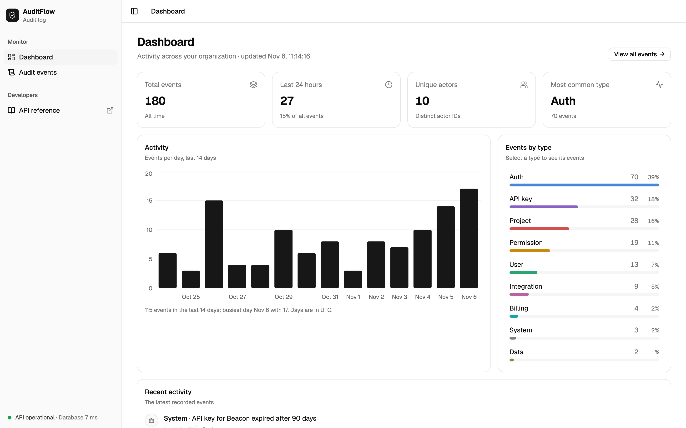
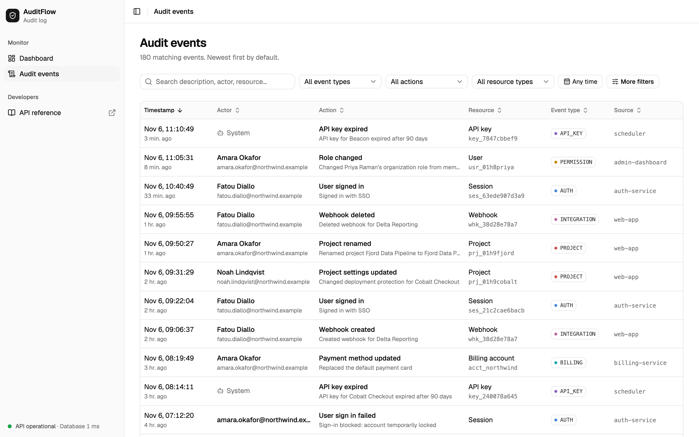
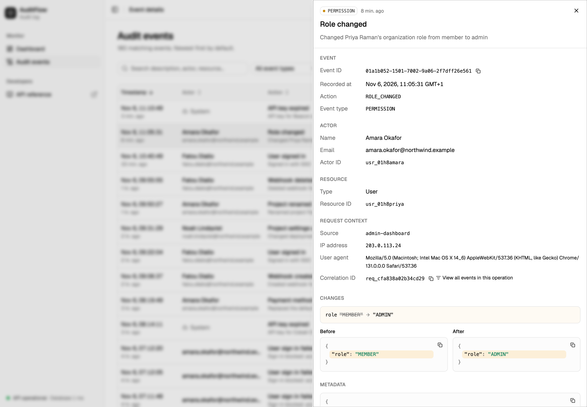
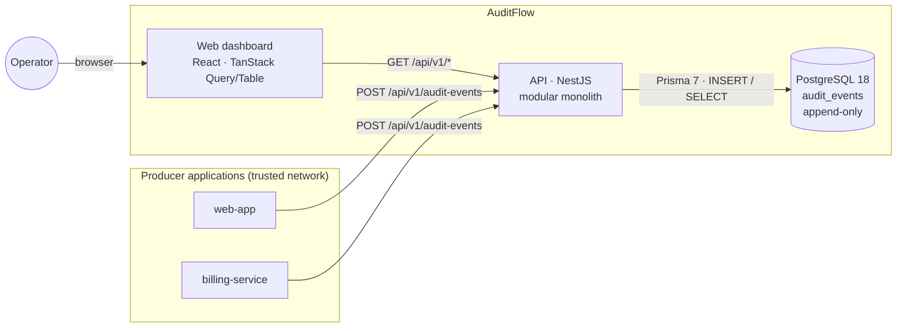
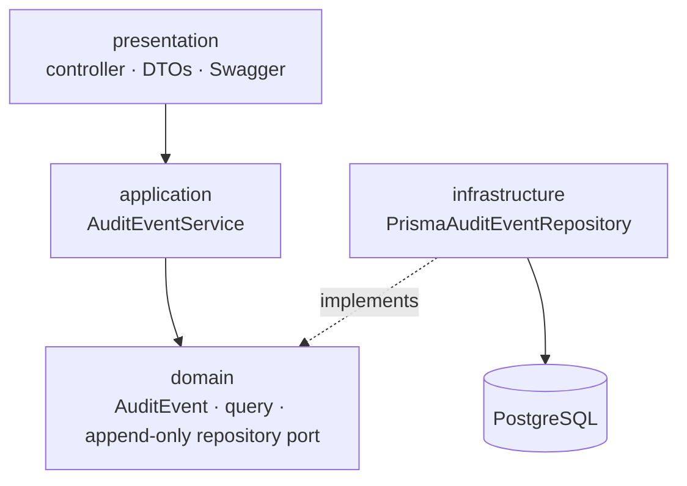

# AuditFlow

An audit log and activity tracking platform. Applications send audit events — _who did what to
which resource, when, from where, and what changed_ — to a REST API. AuditFlow stores them as an
**append-only, immutable** history and provides a dashboard for searching, filtering and inspecting them.



| Audit events                                  | Event details                                         |
| --------------------------------------------- | ----------------------------------------------------- |
|  |  |

> **This is a portfolio MVP.** It deliberately has no authentication, multi-tenancy or retention
> scheduling. See [Security and production readiness](#security-and-production-readiness) before
> deploying it anywhere that matters.

## Contents

- [Features](#features)
- [Architecture](#architecture)
- [Tech stack](#tech-stack)
- [Getting started](#getting-started)
- [Running everything in Docker](#running-everything-in-docker)
- [Commands](#commands)
- [Environment variables](#environment-variables)
- [API](#api)
- [Testing](#testing)
- [Project structure](#project-structure)
- [Design decisions](#design-decisions)
- [Security and production readiness](#security-and-production-readiness)
- [Known limitations](#known-limitations)

## Features

**Ingestion and storage**

- `POST /api/v1/audit-events` with strict validation: identifier formats, length limits, JSON objects
  only for `metadata`/`before`/`after`, per-field size caps (16/32 KB), and a 128 KB request limit.
- The server assigns `id` (UUIDv7) and `createdAt`. Client-supplied values are rejected, not ignored.
- **Immutability at four layers:** no update or delete routes, an append-only repository, frozen
  domain objects, and a PostgreSQL trigger that rejects `UPDATE`/`DELETE` even from direct SQL.

**Querying**

- Server-side pagination, sorting (whitelisted fields only) and filtering by event type, action,
  resource, actor, source, correlation ID and a date range.
- Case-insensitive search across descriptive fields. `%` and `_` are matched literally.
- Each page and its total are read in one `REPEATABLE READ` snapshot, so they always agree.

**Dashboard**

- Key figures, a 14-day activity chart, a breakdown by event type, and recent activity. All of it is
  computed in SQL from real data. An empty database gets an explanatory empty state, not zeros.

**Audit events UI**

- TanStack Table with server-side sorting and pagination. All state lives in the URL (shareable,
  back button works).
- Debounced search, filters fed by real data, date presets, a validated "More filters" form, and
  filter chips.
- Distinct empty states for "no events yet", "no matches" and "page past the end", plus error states
  that show the request ID.

**Event details**

- A side panel at `/events/:id` over the list, keeping filters. It can be deep-linked and closed with Escape.
- Before/after snapshots side by side (stacked on small screens), with a changed-fields summary and highlights.
- A JSON viewer, copy actions, and a link to every event in the same operation (correlation ID).

## Architecture

A **modular monolith** (NestJS) behind a static React SPA, with PostgreSQL as the only infrastructure
dependency.



Inside the API, each feature module is layered. Dependencies point inwards, and the domain knows
nothing about NestJS or Prisma:



- **Contract-first frontend.** The API's OpenAPI document is generated from the code. The web app's
  types are generated from that document (`pnpm api:types`), and CI fails if either is stale.
- **One origin.** In development, Vite proxies `/api` to NestJS. In Docker, nginx does the same.

The full design, including domain model, request lifecycle and ADRs, is in
[docs/architecture.md](docs/architecture.md). The API contract is in [docs/api-design.md](docs/api-design.md),
and the phase-by-phase build log with findings is in [docs/implementation-plan.md](docs/implementation-plan.md).

## Tech stack

| Area    | Technology                                                                                                                                     |
| ------- | ---------------------------------------------------------------------------------------------------------------------------------------------- |
| API     | NestJS 12 (ESM, Express 5), TypeScript 6, class-validator, Swagger/OpenAPI, helmet                                                             |
| Data    | PostgreSQL 18 (UUIDv7, JSONB, `inet`), Prisma 7 with the `pg` driver adapter                                                                   |
| Web     | React 19, Vite 8, Tailwind CSS 4, shadcn/ui (Radix), TanStack Query 5 and Table 8, React Router 8, React Hook Form + Zod 4, Recharts 3, Lucide |
| Tests   | Jest 30 + SWC + supertest against a real database (API); Vitest 5 + Testing Library + MSW (web)                                                |
| Tooling | pnpm workspaces, Biome 2 (format + lint), Docker / Compose, GitHub Actions                                                                     |

## Getting started

**Prerequisites:** Node.js 24 (see `.nvmrc`), pnpm 10, Docker.

```bash
pnpm install
```

```bash
cp .env.example .env
```

```bash
pnpm db:up
```

```bash
pnpm db:deploy
```

```bash
pnpm db:seed
```

```bash
pnpm dev
```

| What       | URL                            |
| ---------- | ------------------------------ |
| Dashboard  | http://localhost:5173          |
| API        | http://localhost:3000/api/v1   |
| Swagger UI | http://localhost:3000/api/docs |

PostgreSQL is published on host port **5433**, so it does not clash with a locally installed
PostgreSQL on 5432. `pnpm db:seed` replaces all events with about 180 deterministic demo events
spread over 30 days.

## Running everything in Docker

```bash
docker compose --profile full up --build
```

This builds and starts PostgreSQL, a one-off `migrate` job, the API and the web app (nginx), in
dependency order. Open http://localhost:8080. To load demo data into the containerised database:

```bash
docker compose --profile full run --rm migrate pnpm --filter @auditflow/api db:seed
```

Plain `docker compose up -d` (or `pnpm db:up`) starts only PostgreSQL, for local development.
Images run as non-root users; the API image contains only production dependencies.

## Commands

| Command                         | What it does                                                                                 |
| ------------------------------- | -------------------------------------------------------------------------------------------- |
| `pnpm dev`                      | API (watch mode) and web (Vite) together                                                     |
| `pnpm build`                    | Production builds of both apps                                                               |
| `pnpm test`                     | API unit + integration tests (needs `pnpm db:up`) and web tests                              |
| `pnpm typecheck`                | TypeScript in every workspace                                                                |
| `pnpm check` / `pnpm check:fix` | Biome formatting, linting and import order (check / apply fixes)                             |
| `pnpm lint` / `pnpm format`     | Biome lint only / format and write                                                           |
| `pnpm db:up` / `pnpm db:down`   | Start / stop PostgreSQL in Docker                                                            |
| `pnpm db:deploy`                | Apply committed migrations                                                                   |
| `pnpm db:migrate`               | Create and apply a migration after a schema change (development), then regenerate the client |
| `pnpm db:seed`                  | Reset and seed demo data (refuses to run with `NODE_ENV=production`)                         |
| `pnpm api:types`                | Regenerate `apps/api/openapi.json` and the web app's API types                               |

API-only: `pnpm --filter @auditflow/api test:unit`, `test:integration`, `db:test:prepare`.

## Environment variables

The root `.env` is shared by Docker Compose and the API. The API validates it at startup and exits
with a list of every invalid variable.

| Variable                                                                | Default                                          | Purpose                                                                     |
| ----------------------------------------------------------------------- | ------------------------------------------------ | --------------------------------------------------------------------------- |
| `DATABASE_URL`                                                          | — (required)                                     | PostgreSQL connection string                                                |
| `PORT`                                                                  | `3000`                                           | API port                                                                    |
| `NODE_ENV`                                                              | `development`                                    | `development` \| `test` \| `production` (JSON logs, Swagger off by default) |
| `CORS_ORIGINS`                                                          | `http://localhost:5173`                          | Comma-separated exact origins; wildcards are rejected                       |
| `SWAGGER_ENABLED`                                                       | `true` outside production                        | Serve `/api/docs`                                                           |
| `LOG_LEVEL`                                                             | `log`                                            | `fatal` … `verbose`                                                         |
| `TEST_DATABASE_URL`                                                     | —                                                | Integration-test database; its name must end in `_test`                     |
| `POSTGRES_USER` / `POSTGRES_PASSWORD` / `POSTGRES_DB` / `POSTGRES_PORT` | `auditflow` / `auditflow` / `auditflow` / `5433` | Docker Compose database                                                     |
| `VITE_API_BASE_URL`                                                     | empty (same origin)                              | Web build: API origin, if the API is served elsewhere                       |

## API

All endpoints are under `/api/v1`. Errors share one shape (`statusCode`, `error`, `message`,
`details` for validation, `path`, `requestId`, `timestamp`) and never include stack traces or
database errors.

| Method and path            | Purpose                                                                                                                                                                             |
| -------------------------- | ----------------------------------------------------------------------------------------------------------------------------------------------------------------------------------- |
| `POST /audit-events`       | Record an event → `201` with `Location`                                                                                                                                             |
| `GET /audit-events`        | List with `page`, `limit` (≤ 100), `search`, `eventType`, `action`, `resourceType`, `resourceId`, `actorId`, `source`, `correlationId`, `dateFrom`, `dateTo`, `sortBy`, `sortOrder` |
| `GET /audit-events/:id`    | One event → `200`, or `404` / `400`                                                                                                                                                 |
| `GET /audit-events/stats`  | Dashboard aggregates                                                                                                                                                                |
| `GET /audit-events/facets` | Distinct values for filter options                                                                                                                                                  |
| `GET /health`              | API and database health → `200` / `503`                                                                                                                                             |

Record an event:

```bash
curl -i -X POST http://localhost:3000/api/v1/audit-events \
  -H 'Content-Type: application/json' \
  -d '{
    "eventType": "USER",
    "action": "USER_UPDATED",
    "resourceType": "USER",
    "resourceId": "usr_123",
    "actorId": "usr_456",
    "actorEmail": "admin@example.com",
    "actorName": "John Doe",
    "description": "Updated user permissions",
    "metadata": { "source": "admin-dashboard" },
    "before": { "role": "USER" },
    "after": { "role": "ADMIN" },
    "ipAddress": "127.0.0.1",
    "userAgent": "Mozilla/5.0",
    "correlationId": "req_abc123",
    "source": "example-app"
  }'
```

Query events (permission changes since 1 November, newest first):

```bash
curl 'http://localhost:3000/api/v1/audit-events?eventType=PERMISSION&dateFrom=2026-11-01T00:00:00Z&limit=50'
```

Response shape: `{ "data": [ … ], "meta": { "page": 1, "limit": 50, "total": 19, "totalPages": 1 } }`.
The full contract, with every rule and status code, is in [docs/api-design.md](docs/api-design.md)
and in Swagger UI.

## Testing

```bash
pnpm db:up && pnpm test
```

- **API unit tests (Jest):** domain invariants and freezing, sort whitelist, query builders, LIKE
  escaping, DTO validation messages, error mapping, config validation, and seed data quality.
- **API integration tests (Jest + supertest, real PostgreSQL):** ingestion, filters, pagination,
  sorting, search, stats, facets, health 200/503, error format, body limits, CORS and headers, the
  OpenAPI contract, and **immutability** (no mutation routes; the trigger rejects ORM and raw SQL
  updates). They run against `auditflow_test` and refuse any database not named `*_test`.
- **Web tests (Vitest + Testing Library + MSW):** the app shell and routing; loading, empty and error
  states; search debounce; filters and URL sync; sorting and pagination requests; the "More filters"
  form; event details including before/after; copy actions; and JSON viewer safety. Components run
  their real data-fetching code, and MSW mocks only HTTP.

CI ([.github/workflows/ci.yml](.github/workflows/ci.yml)) runs `biome ci`, typecheck, all tests
against a PostgreSQL 18 service, production builds and a check that the OpenAPI contract and
generated types are committed and current. It also builds both Docker images.

## Project structure

```
apps/
  api/                     NestJS API
    prisma/                schema and migrations (incl. CHECK constraints and immutability trigger)
    src/
      common/              error filter, validation pipe, middleware, validators
      config/              validated environment configuration
      database/            PrismaService
      modules/
        audit-events/      domain · application · infrastructure · presentation
        health/
      seed/                deterministic demo data
      scripts/             seed and OpenAPI generation entry points
    test/                  integration tests and helpers
  web/                     React SPA
    src/
      app/                 providers, router
      components/          layout, shared (states, JSON viewer), ui (shadcn/ui)
      features/            audit-events, dashboard, health
      lib/                 API client and generated types, formatting
docs/                      architecture, API design, implementation log, screenshots
docker/                    PostgreSQL init (test database)
```

## Design decisions

The most important ones, with the full list and reasoning in
[docs/architecture.md §8](docs/architecture.md#8-architecture-decision-records-summary):

- **Immutability is a domain invariant, enforced in the database too.** A trigger rejects
  `UPDATE`/`DELETE` for every role. The application cannot express a mutation, and even a developer
  with a SQL console cannot change history accidentally.
- **The database assigns IDs (UUIDv7) and timestamps.** That gives one trusted clock and time-ordered
  keys, and producers cannot backdate events.
- **Unknown fields are rejected, not stripped.** Producers learn about contract mistakes immediately,
  including attempts to set `id` or `createdAt`.
- **The URL is the source of truth for table state.** Every view is shareable and back/forward
  behave as expected, with no global store.
- **Types are generated from OpenAPI.** There is one source of truth for the contract and no
  hand-maintained duplicates.
- **No speculative abstractions.** There is one application service rather than five single-method
  use-case classes, a custom config module instead of a library whose import-time validation made
  testing harder, and no CQRS or mapper libraries.

## Security and production readiness

AuditFlow is built to be safe by default within its MVP scope, but it is **not production-ready as is**:

- **No authentication.** Every endpoint, including ingestion, assumes a trusted network. Before
  exposing it, protect ingestion with service-to-service credentials (mTLS, signed tokens or API keys)
  and rate limiting, and protect the dashboard and read API with operator SSO and role-based access.
- **Audit logs contain personal data:** emails, IP addresses, user agents, before/after snapshots.
  Production use needs retention and deletion policies that meet your legal obligations, encryption in
  transit and at rest, restricted access, and a rule that producers redact secrets and sensitive values
  before sending them.
- **Database privileges.** Run the API with a role that has only `INSERT` and `SELECT` on
  `audit_events`. The trigger blocks `UPDATE`/`DELETE`, but `TRUNCATE` (used by the dev seed and
  tests) requires ownership and must not be available to the application.
- **What is already in place:** strict input validation and size limits, parameterised queries only
  and whitelisted sorting, uniform errors without internals, an explicit CORS allow-list, helmet
  headers, a CSP and other headers from nginx, request IDs, logs without bodies or query strings,
  non-root containers, and configuration validated at startup.

## Known limitations

- No authentication, authorization or multi-tenancy (by design of the MVP).
- `createdAt` is ingestion time. A producer-reported `occurredAt` would be a separate, untrusted field.
- Search uses `ILIKE`, which is fine at demo scale. Large volumes need `pg_trgm` indexes or full-text search.
- Offset pagination degrades on very deep pages. Keyset pagination on `(createdAt, id)` is the scale path.
- Dashboard aggregates are computed per request. At scale they would move to rollups or materialised views.
- Ingestion is not idempotent: a retried request records a second event. An `Idempotency-Key` header is the natural extension.
- No retention or archival jobs, and no tamper-evidence (for example hash chaining) beyond database-level immutability.
- A single light theme. The design tokens are structured to add a dark theme later.
