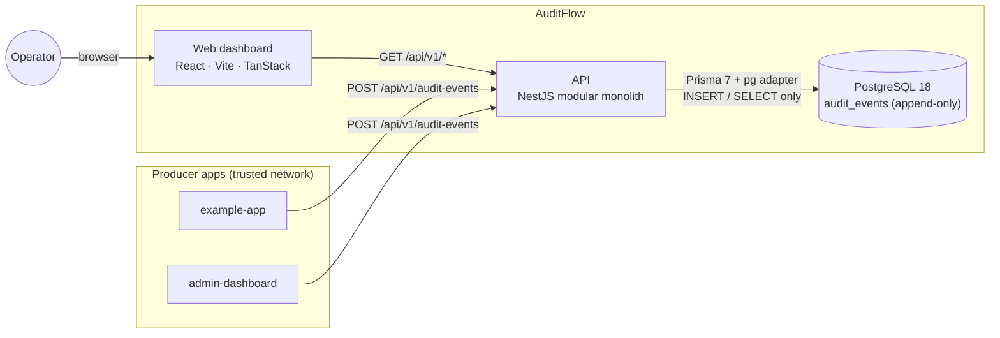
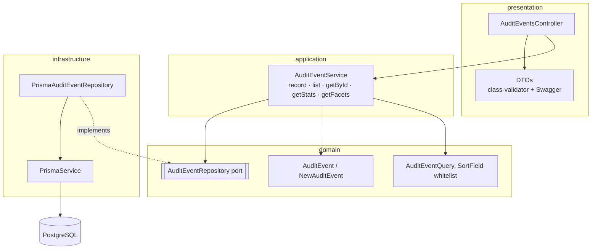
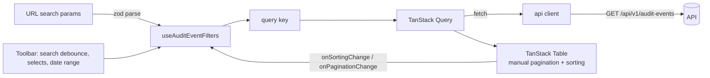

# AuditFlow — Architecture

Status: **Phase 0 proposal**. This document describes the target architecture. Sections marked
_Decision_ record choices made where the brief was ambiguous; they are summarised as ADRs at the end.

## 1. Goals and non-goals

AuditFlow collects audit events from trusted applications, stores them as an **append-only,
immutable** history, and lets operators search, filter and inspect them through a dashboard.

In scope for the MVP: ingestion API, query API, event details, aggregate stats for the dashboard,
seed data, tests, Docker, CI, documentation.

Explicitly out of scope: authentication/authorization, multi-tenancy, message brokers, Redis,
WebSockets, retention scheduling, billing. These are listed again under _Known limitations_ so the
gap is visible rather than implied.

## 2. System context



There is one deployable backend (modular monolith) and one static frontend. In local development
the Vite dev server proxies `/api` to the API, so the browser sees a single origin. In the Docker
setup nginx serves the built frontend and proxies `/api` the same way.

## 3. Repository layout

The repository is currently empty (no code, no git history), so the following is a fresh layout.

```
AuditFlow/
├── apps/
│   ├── api/                          # NestJS 12 (ESM)
│   │   ├── prisma/
│   │   │   ├── schema.prisma
│   │   │   ├── migrations/
│   │   │   └── seed/                 # deterministic demo data + reset-and-seed script
│   │   ├── prisma.config.ts
│   │   ├── src/
│   │   │   ├── common/
│   │   │   │   ├── decorators/       # e.g. @ApiPaginatedResponse
│   │   │   │   ├── dto/              # shared Swagger DTOs (ErrorResponseDto)
│   │   │   │   ├── filters/          # global exception filter → uniform error body
│   │   │   │   ├── http/             # small request helpers
│   │   │   │   ├── logging/          # logger factory (JSON in production)
│   │   │   │   ├── middleware/       # request id, request logging (no bodies), JSON body parser
│   │   │   │   ├── pipes/            # validation pipe factory (field-level errors)
│   │   │   │   └── validators/       # @IsJsonObject, @MaxJsonBytes
│   │   │   ├── config/               # env schema, typed AppConfig, AppConfigModule, .env loader
│   │   │   ├── database/             # PrismaService, DatabaseModule
│   │   │   ├── generated/prisma/     # Prisma client output (gitignored)
│   │   │   ├── modules/
│   │   │   │   ├── audit-events/
│   │   │   │   │   ├── domain/           # AuditEvent, invariants, repository port, query types
│   │   │   │   │   ├── application/      # use cases: record, list, get, stats, facets
│   │   │   │   │   ├── infrastructure/   # PrismaAuditEventRepository, row mappers
│   │   │   │   │   ├── presentation/     # controller, request/response DTOs
│   │   │   │   │   └── audit-events.module.ts
│   │   │   │   └── health/
│   │   │   ├── app.module.ts
│   │   │   ├── bootstrap.ts          # shared app setup (used by main.ts and tests)
│   │   │   ├── swagger.ts            # OpenAPI document + Swagger UI
│   │   │   └── main.ts
│   │   ├── test/
│   │   │   ├── integration/          # supertest against real Postgres
│   │   │   └── support/              # test app factory, db reset, builders
│   │   └── Dockerfile
│   └── web/                          # React 19 + Vite 8
│       ├── src/
│       │   ├── app/
│       │   │   ├── providers/        # QueryClientProvider, Toaster, Tooltip
│       │   │   └── router/           # route tree
│       │   ├── components/
│       │   │   ├── layout/           # AppShell, Sidebar, Header
│       │   │   ├── shared/           # EmptyState, ErrorState, CopyButton, JsonViewer, PageHeader
│       │   │   └── ui/               # shadcn/ui primitives (generated, lightly edited)
│       │   ├── features/
│       │   │   ├── dashboard/
│       │   │   │   ├── api/  components/  hooks/  pages/
│       │   │   └── audit-events/
│       │   │       ├── api/          # query keys, fetchers, query hooks
│       │   │       ├── components/   # table, columns, toolbar, filters, details panel
│       │   │       ├── hooks/        # useAuditEventFilters (URL ⇄ typed state)
│       │   │       ├── pages/
│       │   │       └── types/
│       │   ├── lib/
│       │   │   ├── api/              # fetch client, ApiError, generated OpenAPI types
│       │   │   └── utils.ts          # cn(), date formatting
│       │   ├── styles/               # Tailwind entry + design tokens
│       │   └── test/                 # Vitest setup, MSW server, fixtures
│       ├── nginx.conf
│       └── Dockerfile
├── docker/postgres/init/             # creates auditflow_test database
├── docs/
├── .github/workflows/ci.yml
├── biome.json
├── docker-compose.yml
├── package.json                      # root scripts
├── pnpm-workspace.yaml
├── tsconfig.base.json
├── .env.example
└── README.md
```

_Decision — no `packages/` directory._ A shared contracts package would duplicate the API DTOs.
Instead the API's OpenAPI document is the single contract, and the web app consumes TypeScript types
generated from it (`openapi-typescript`, dev-only). CI fails if the generated file is stale.

The dashboard gets its own small feature folder because its stats query and widgets do not belong to
the audit-events table feature, even though both call the same backend module.

## 4. Backend architecture

### 4.1 Layers inside a feature module



| Layer            | Responsibility                                                                                                              | May depend on                |
| ---------------- | --------------------------------------------------------------------------------------------------------------------------- | ---------------------------- |
| `presentation`   | HTTP: routes, DTO validation, status codes, Swagger, mapping DTO ⇄ domain                                                   | application, domain          |
| `application`    | `AuditEventService`: the use cases; orchestrates domain + repository; throws domain errors (e.g. `AuditEventNotFoundError`) | domain                       |
| `domain`         | Plain TypeScript: entity types, invariants, query value objects, repository **interface**                                   | nothing (no Nest, no Prisma) |
| `infrastructure` | Prisma implementation of the port; row ⇄ entity mapping; SQL for aggregates                                                 | domain, database             |

The domain layer stays free of Nest and Prisma, so it can be unit tested without a container.
The application service carries `@Injectable()` because Nest wires it. It depends on the port
through an injection token, not on Prisma. Domain errors extend a framework-free `NotFoundError`,
which the global exception filter maps to 404.

_Decision — one application service, not one class per use case._ The five use cases are each a few
lines of orchestration, so separate classes would add files without adding clarity. If a use case
grows real logic, it can be extracted without touching the controller's contract.

_Decision — no CQRS buses, no generic base repository, no mapper library._ Mapping is explicit
functions (`infrastructure/audit-event.mapper.ts`, `presentation/audit-event.presenter.ts`).

### 4.2 Request lifecycle

1. Express-level middleware runs first, in this order:
   - the request-id middleware reuses a valid incoming `X-Request-Id` or generates one, and echoes it;
   - the request logger registers a completion hook;
   - helmet and CORS;
   - the JSON body parser (128 KB limit), which turns parser failures into `400`/`413`/`415` with
     fixed messages instead of raw parser text.
2. Global `ValidationPipe` (`whitelist`, `forbidNonWhitelisted`, `transform`) validates body and query DTOs.
   Unknown properties are rejected, including client attempts to set `id` or `createdAt`.
3. Controller maps the DTO to a domain input and calls one use case.
4. Use case calls the repository port; Prisma implementation executes parameterised queries.
5. Controller returns a response DTO; Nest serialises it.
6. Any thrown error goes through `AllExceptionsFilter`, which produces the uniform error body
   (see `api-design.md`). Unknown errors are logged with stack and request id, then returned as a
   generic 500 with no internals.
7. When the response finishes, the request logger writes method, path, status, duration and request id.
   It **never logs bodies or query strings**, because audit payloads and search terms may contain
   personal data. It is middleware rather than an interceptor so that 404s and body-parser rejections,
   which never reach a route handler, are logged too.

### 4.3 Domain model

```ts
// domain/audit-event.ts (sketch)
export interface NewAuditEvent {
  // what a producer submits, after validation
  readonly eventType: string;
  readonly action: string;
  readonly resourceType: string;
  readonly resourceId: string | null;
  readonly actorId: string | null;
  readonly actorEmail: string | null;
  readonly actorName: string | null;
  readonly description: string;
  readonly metadata: JsonObject;
  readonly before: JsonObject | null;
  readonly after: JsonObject | null;
  readonly ipAddress: string | null;
  readonly userAgent: string | null;
  readonly correlationId: string | null;
  readonly source: string;
}

export interface AuditEvent extends NewAuditEvent {
  // what was recorded
  readonly id: string; // assigned by the database
  readonly createdAt: Date; // assigned by the database
}

export interface AuditEventRepository {
  append(event: NewAuditEvent): Promise<AuditEvent>;
  findById(id: string): Promise<AuditEvent | null>;
  findPage(query: AuditEventQuery): Promise<Page<AuditEvent>>;
  getStatsSnapshot(): Promise<AuditEventStatsSnapshot>; // computed in SQL at the database's now()
  getFacets(): Promise<AuditEventFacets>;
}
```

`NewAuditEvent` has no `id` or `createdAt`. A producer cannot express them in the domain, which
enforces "never trust client timestamps" at the type level and not only through DTO validation.

The port is append-only. There is no `update`, `delete`, `save` or `upsert`, so application code
has no repository method that could change a recorded event.

Records returned from the repository are deep-frozen (`Object.freeze`) by the mapper, so accidental
in-process mutation fails loudly in tests.

### 4.4 Immutability — defence in depth

Immutability is a core invariant, enforced at four independent layers:

| Layer                   | Mechanism                                                                   | Verified by                                                             |
| ----------------------- | --------------------------------------------------------------------------- | ----------------------------------------------------------------------- |
| HTTP                    | No `PUT`/`PATCH`/`DELETE` routes exist for audit events                     | Integration test: mutation verbs return 404 and the record is unchanged |
| Application/domain      | Repository port is append-only; entities are `readonly` and frozen          | Type checks; unit test that mutation of a returned entity throws        |
| Database                | `BEFORE UPDATE OR DELETE` row trigger on `audit_events` raises an exception | Integration test: raw `UPDATE`/`DELETE` via Prisma is rejected          |
| Operations (documented) | Production app role granted `INSERT, SELECT` only                           | README production checklist                                             |

`TRUNCATE` is intentionally **not** blocked by the trigger. It needs table-owner privileges and is
what the dev-only seed reset and test cleanup use. The README states that the production runtime role
must not own the table.

### 4.5 Persistence

PostgreSQL 18, accessed through Prisma 7 with the `@prisma/adapter-pg` driver adapter and the
`prisma-client` generator (TypeScript output into `src/generated/prisma`, ESM).

```prisma
model AuditEvent {
  id            String   @id @default(dbgenerated("uuidv7()")) @db.Uuid
  eventType     String   @map("event_type")     @db.VarChar(64)
  action        String                          @db.VarChar(100)
  resourceType  String   @map("resource_type")  @db.VarChar(64)
  resourceId    String?  @map("resource_id")    @db.VarChar(255)
  actorId       String?  @map("actor_id")       @db.VarChar(255)
  actorEmail    String?  @map("actor_email")    @db.VarChar(320)
  actorName     String?  @map("actor_name")     @db.VarChar(200)
  description   String                          @db.VarChar(1000)
  metadata      Json     @default("{}")         @db.JsonB
  before        Json?                           @db.JsonB
  after         Json?                           @db.JsonB
  ipAddress     String?  @map("ip_address")     @db.Inet
  userAgent     String?  @map("user_agent")     @db.VarChar(512)
  correlationId String?  @map("correlation_id") @db.VarChar(128)
  source        String                          @db.VarChar(100)
  createdAt     DateTime @default(now()) @map("created_at") @db.Timestamptz(3)

  @@index([createdAt(sort: Desc), id(sort: Desc)])
  @@index([eventType, createdAt(sort: Desc)])
  @@index([action, createdAt(sort: Desc)])
  @@index([actorId, createdAt(sort: Desc)])
  @@index([resourceType, resourceId])
  @@index([correlationId])
  @@map("audit_events")
}
```

Notes:

- **IDs are UUIDv7** generated by PostgreSQL 18's native `uuidv7()`. They are time-ordered, which
  keeps B-tree inserts at the right edge of the index and makes `id` a natural tie-breaker for
  `createdAt` sorting. They are still RFC 9562 UUIDs, so the "id: UUID" requirement holds.
- **Timestamps come from the database clock** (`now()`), the single trusted time source regardless of
  how many API instances run. Stored as `timestamptz(3)` (millisecond precision, matching JS `Date`).
- **Composite indexes** lead with the filter column and end with `createdAt DESC`. They cover the
  recommended single-column lookups (leftmost prefix) and also serve the dominant
  "filter + newest first" query without a sort step.
- **Hand-written migration SQL** (appended to the Prisma-generated migration) adds what Prisma cannot
  express:
  - `CHECK (jsonb_typeof(metadata) = 'object')` and the same for `before`/`after` when not null.
  - `CHECK` constraints for non-blank `event_type`, `action`, `resource_type`, `description`, `source`.
  - The immutability trigger function and trigger.
- **JSON null semantics.** An absent or `null` `before`/`after` is stored as SQL `NULL`
  (`Prisma.DbNull`), never as JSON `null`. The mapper normalises this so the API never
  distinguishes the two.
- `ipAddress` uses `inet`, so PostgreSQL rejects malformed addresses even if validation were bypassed.

### 4.6 Querying

- Offset pagination (`page`, `limit ≤ 100`) because the brief requires `total`/`totalPages`.
  `findMany` and `count` run in one `REPEATABLE READ` transaction, so `data` and `total` come from the
  same snapshot. Under the default `READ COMMITTED` each statement would see its own. The dashboard
  aggregates and facets use the same isolation level.
- Sorting goes through a **whitelist map** from public field names to Prisma `orderBy` clauses.
  A secondary `id` sort in the same direction guarantees stable ordering across pages.
- Exact-match filters (`eventType`, `action`, `resourceType`, `actorId`, `resourceId`, `source`,
  `correlationId`) and a
  half-open time window `[dateFrom, dateTo)`.
- `search` is a case-insensitive substring match across `description`, `actorEmail`, `actorName`,
  `actorId`, `resourceId`, `action` and `correlationId`. Prisma's `contains` does **not** escape LIKE
  wildcards (verified by an integration test), so `escapeLikePattern()` escapes `\`, `%` and `_` and
  they match literally.
- Request validation stops at the first failing rule per field. class-validator evaluates property
  decorators bottom-up, so DTOs put the most basic check (e.g. `@IsString`) closest to the property.
  Unit tests pin the resulting messages (a missing field reports "must be a string", not a length rule).
- Aggregates for the dashboard (counts, distinct actors, group-by, daily buckets) use Prisma
  `groupBy`/`count` where possible and `$queryRaw` tagged templates (parameterised) where not.
- Nothing loads the full table into memory. Every list query is bounded by `limit`, and aggregates
  are computed in SQL.

### 4.7 Configuration

`main.ts` loads the root `.env` (existing variables win) and validates it against a class-validator
schema (`config/env.schema.ts`). If anything is invalid, the process exits with code 1 and a readable
list of every invalid variable. The validated, frozen `AppConfig` is passed explicitly to
`AppModule.forRoot(config)` and injected by class token, so the rest of the app never reads
`process.env`. Using class-validator here, as the API already does elsewhere, avoids adding Zod to the
backend.

_Decision — no `@nestjs/config`._ `ConfigModule.forRoot()` reads and validates the environment when
the module file is imported. That makes it awkward for integration tests to build the app with a
different configuration (for example, an unreachable database to test the 503 health response). A
~60-line config module created at startup is simpler and fully testable.

| Variable            | Required   | Default                            | Purpose                                                 |
| ------------------- | ---------- | ---------------------------------- | ------------------------------------------------------- |
| `NODE_ENV`          | no         | `development`                      | `development` \| `test` \| `production`                 |
| `PORT`              | no         | `3000`                             | API port                                                |
| `DATABASE_URL`      | **yes**    | —                                  | PostgreSQL connection string                            |
| `CORS_ORIGINS`      | no         | `http://localhost:5173`            | Comma-separated explicit allow-list; `*` rejected       |
| `SWAGGER_ENABLED`   | no         | `true` (non-prod) / `false` (prod) | Serve `/api/docs`                                       |
| `LOG_LEVEL`         | no         | `log`                              | Nest logger level                                       |
| `TEST_DATABASE_URL` | tests only | —                                  | Integration-test database; its name must end in `_test` |

Web: `VITE_API_BASE_URL` (optional, defaults to `/api`, which is same-origin through the dev proxy or nginx).

### 4.8 Security posture (MVP)

- **No authentication, by design of the brief.** The ingestion endpoint assumes a trusted network.
  The README and Swagger description say so prominently, and list what production needs: service
  credentials for producers, operator SSO/RBAC for readers, rate limiting.
- Input: strict DTO validation, unknown fields rejected, string lengths bounded, JSON fields must be
  objects with serialized size caps, global JSON body limit (128 KB, returns 413).
- Output: React escapes everything. The JSON viewer renders text nodes only, and nothing uses
  `dangerouslySetInnerHTML`. Stored strings are trimmed but not HTML-escaped at write time, because
  audit data must stay faithful to what was sent.
- SQL: Prisma query builder and tagged-template raw queries only, never string-concatenated SQL.
  Sort fields come from the whitelist.
- `helmet` for standard headers. CORS uses an explicit allow-list from config.
- Errors never include stack traces, Prisma error codes or SQL.
- Logs exclude request/response bodies.
- **Sensitive data notice:** audit logs routinely contain personal data (emails, IPs, user agents,
  before/after snapshots). Production deployments need retention policies, access control,
  encryption at rest and in transit, and a policy on what producers may put in `metadata`/`before`/`after`.

## 5. Frontend architecture

### 5.1 Routing and layout

| Route              | View                                                                     |
| ------------------ | ------------------------------------------------------------------------ |
| `/`                | Dashboard (stats, activity by event type, daily volume, recent activity) |
| `/events`          | Audit events table                                                       |
| `/events/:eventId` | Table plus event details in a right-side sheet (nested route)            |
| `*`                | Not found                                                                |

_Decision — details as a URL-addressable side panel._ The details view is a nested route rendered
in a shadcn `Sheet` over the table. Deep links work, the browser back button closes the panel, and
the table keeps its filters and scroll position. On small screens the sheet is full-width.

Layout: persistent sidebar (collapsible to a drawer on mobile), slim header with page title and an
"API docs" link to Swagger, content area with a max width suited to dense tables.

### 5.2 Data flow



- **The URL is the single source of truth for table state** (page, limit, sort, all filters).
  A Zod schema parses search params into a typed filter object. Invalid values fall back to defaults
  and are never sent to the API. Changing any filter resets `page` to 1.
- TanStack Table runs in `manualPagination` / `manualSorting` mode. It renders and emits intents,
  and never sorts or slices data locally.
- TanStack Query owns server state. Query keys come from a factory
  (`auditEventKeys.list(filters)`), and `placeholderData: keepPreviousData` keeps the table stable while
  the next page loads.
- **React Hook Form + Zod** handle the "More filters" popover (actor ID, resource ID, source,
  correlation ID), where draft state, input validation and Apply/Reset are needed.
  The date range has its own calendar popover, which only produces ordered ranges.
  Simple controls (search, event type, action, resource type) apply directly.
- Filter dropdown options come from `GET /audit-events/facets`, so they always reflect real data.

_Decision — the server is the authority on validation._ Frontend Zod schemas only parse URL state and
give fast form feedback. They do not reimplement ingestion rules, and the frontend never ingests events.

### 5.3 UI system

- Tailwind CSS 4 with CSS-variable design tokens (shadcn convention). Light theme is primary.
  Tokens are structured so a dark theme could be added later; dark mode is not in MVP scope.
- shadcn/ui primitives: button, input, select, popover, calendar, sheet, table, badge, card, skeleton,
  separator, tooltip, dropdown-menu, scroll-area, sonner, chart (Recharts wrapper).
- Shared components where they earn their place: `EmptyState`, `ErrorState` (with retry),
  `PageHeader`, `CopyButton`, `JsonViewer` (collapsible, monospace, copy), `DiffPanel`
  (before/after side by side ≥ `lg`, stacked below).
- Tabular figures for timestamps and counts, and relative times with an absolute-time tooltip.
  Color is reserved for status and category accents.

## 6. Testing strategy

| Level           | Tooling                                               | What it covers                                                                                                                                                                                                                                            |
| --------------- | ----------------------------------------------------- | --------------------------------------------------------------------------------------------------------------------------------------------------------------------------------------------------------------------------------------------------------- |
| API unit        | Jest 30 (ESM) + `@swc/jest`                           | Domain invariants and freezing; sort whitelist mapping; query DTO validation (bounds, dates, unknown sort field); JSON size/shape validators; exception filter output; env validation                                                                     |
| API integration | Jest + supertest + real PostgreSQL (`auditflow_test`) | POST success/validation/unknown fields/timestamp rejection; GET by id and 404; malformed UUID → 400; filters; pagination meta; sorting incl. rejected fields; search escaping; stats and facets; immutability (no mutation routes, DB trigger); health up |
| Web component   | Vitest 5 + Testing Library + MSW                      | Table loading skeleton / empty / error + retry; filter interactions update URL and refetch; clear filters; details panel rendering incl. before/after and copy; dashboard empty state                                                                     |

Integration tests run against PostgreSQL rather than mocks. A Jest `globalSetup` applies migrations to
the test database, and each test file truncates `audit_events` before seeding its own fixtures.
MSW intercepts at the network layer in web tests, so components run their real fetch and query code.
Fixtures are typed with the generated OpenAPI types, so contract drift fails type checking.

_Spike result (Phase 0):_ NestJS 12 is ESM-only. A throwaway spike confirmed that Nest DI with
`emitDecoratorMetadata` works under Jest 30 with `--experimental-vm-modules` and `@swc/jest`
(legacy decorators + decorator metadata).

## 7. Tooling and versions

Checked against the npm registry on 2026-11-05. The table records deliberate deviations from `latest`.

| Area     | Choice                                                                                       | Note                                                                                                                        |
| -------- | -------------------------------------------------------------------------------------------- | --------------------------------------------------------------------------------------------------------------------------- |
| Runtime  | Node 24 LTS, pnpm 10.28                                                                      | React Router 8 requires Node ≥ 22.22                                                                                        |
| Language | TypeScript **6.0.x**                                                                         | TS 7 is `latest`, but ts-jest (`<7`), Nest CLI (`~6.0`) and `@nestjs/swagger` (`^5.5 \|\| ^6`) don't support it yet         |
| API      | NestJS 12.3 (Express 5), `@nestjs/swagger` 12, class-validator 0.15, helmet 8                | ESM                                                                                                                         |
| ORM      | Prisma **7.10.1** + `@prisma/adapter-pg`                                                     | npm `latest` tag currently points to `8.0.0-rc.30`; we use the stable 7.x line                                              |
| DB       | PostgreSQL 18 (Docker)                                                                       | Native `uuidv7()`; host port **5433** (5432 is commonly taken by a local Postgres)                                          |
| Web      | React 19, Vite 8, `@vitejs/plugin-react` 6, Tailwind 4, shadcn CLI 4                         | shadcn `radix-nova` style (Radix primitives, Lucide, Geist font); `cn` package (shadcn's clsx + tailwind-merge replacement) |
| Data/UI  | TanStack Query 5, TanStack Table **8.21**, React Router 8, RHF 7 + Zod 4, Recharts 3, Lucide | Table v8 chosen over v9 (stable since Aug 2026) for the mature shadcn data-table recipe and docs                            |
| Tests    | Jest 30 + `@swc/jest` + supertest (API); Vitest 5 + Testing Library + MSW (web)              |                                                                                                                             |
| Quality  | Biome 2.6 (format + lint + import sorting)                                                   | See note below                                                                                                              |
| Contract | `openapi-typescript` (dev)                                                                   | Generates `apps/web/src/lib/api/schema.d.ts` from the API's OpenAPI JSON                                                    |

**Biome + NestJS gotcha:** Biome's `useImportType` rule would turn constructor-injected classes into
type-only imports, which erases the runtime metadata Nest DI needs. That rule is disabled for
`apps/api/**`, and parameter decorators are enabled in the parser. Type-only imports there are still
enforced by TypeScript's `verbatimModuleSyntax`. Likewise, `noStaticOnlyClass` is disabled for
`apps/api/**/*.module.ts`, because a Nest dynamic module must be a class with a static `forRoot()`
(the class itself is the module token). These are scoped, explained overrides, not suppressions of
real errors.

## 8. Architecture decision records (summary)

| #   | Decision                                                                                  | Alternatives considered                         | Why                                                                                          |
| --- | ----------------------------------------------------------------------------------------- | ----------------------------------------------- | -------------------------------------------------------------------------------------------- |
| 1   | Modular monolith, feature modules with domain/application/infrastructure/presentation     | Flat Nest services; microservices               | Brief requires it; keeps the domain testable without overbuilding                            |
| 2   | Append-only repository port + DB trigger + readonly entities                              | Frontend-only restriction; ORM-level guard only | Immutability must hold even if a developer bypasses the app layer                            |
| 3   | DB-generated UUIDv7 and `now()`                                                           | App-generated `randomUUID()` and `new Date()`   | Single trusted clock; time-ordered keys; less application code                               |
| 4   | OpenAPI → generated TS types for the web                                                  | Shared `packages/contracts`; hand-written types | One source of truth with no duplication; drift caught in CI                                  |
| 5   | URL as the source of truth for table state                                                | Component state; global store                   | Shareable/bookmarkable views; back button works; no extra store                              |
| 6   | Details as nested-route side sheet                                                        | Separate full page                              | Keeps list context while remaining deep-linkable                                             |
| 7   | Offset pagination                                                                         | Keyset/cursor                                   | Brief requires `total`/`totalPages`; keyset noted as scale path                              |
| 8   | Reject unknown body fields (incl. `id`, `createdAt`) with 400                             | Silently strip                                  | Producers learn about contract mistakes immediately                                          |
| 9   | Strict identifier format for `eventType`/`action`/`resourceType` (`SCREAMING_SNAKE_CASE`) | Free-form strings                               | Exact-match filters and facets stay clean; matches the brief's examples                      |
| 10  | NestJS 12 (ESM) with Jest via SWC in ESM mode                                             | NestJS 11 (CJS) + classic ts-jest               | Current major; spike proved feasibility. Fallback: Nest 11 if a blocker appears in Phase 1–2 |
| 11  | Custom health check (`SELECT 1`)                                                          | `@nestjs/terminus`                              | One dependency avoided for a single DB probe                                                 |
| 12  | Own config module (`AppModule.forRoot(config)`)                                           | `@nestjs/config`                                | Config created at startup, so tests can build the app with their own; one dependency fewer   |
| 13  | Request logging and JSON parsing as Express middleware                                    | Nest interceptor; `app.useBodyParser`           | Covers 404s and parser errors; parser failures get stable, client-safe messages              |

## 9. Known limitations (planned to be documented in README)

- No authentication or authorization. Ingestion must sit behind a trusted network or gateway before production.
- `createdAt` is ingestion time. A producer-reported `occurredAt` (untrusted, stored separately) is a
  natural extension.
- Substring search uses `ILIKE`, which is fine at demo scale. Large datasets need `pg_trgm` GIN indexes
  or full-text search.
- Offset pagination degrades on deep pages. Keyset pagination on `(createdAt, id)` is the scale path.
- `TRUNCATE` is possible for the table owner. Production must run the app with an `INSERT/SELECT`-only role.
- No retention or archival. Tamper-evidence such as hash chaining is out of scope.
- Dashboard stats are computed per request. At scale they would move to materialised rollups.
